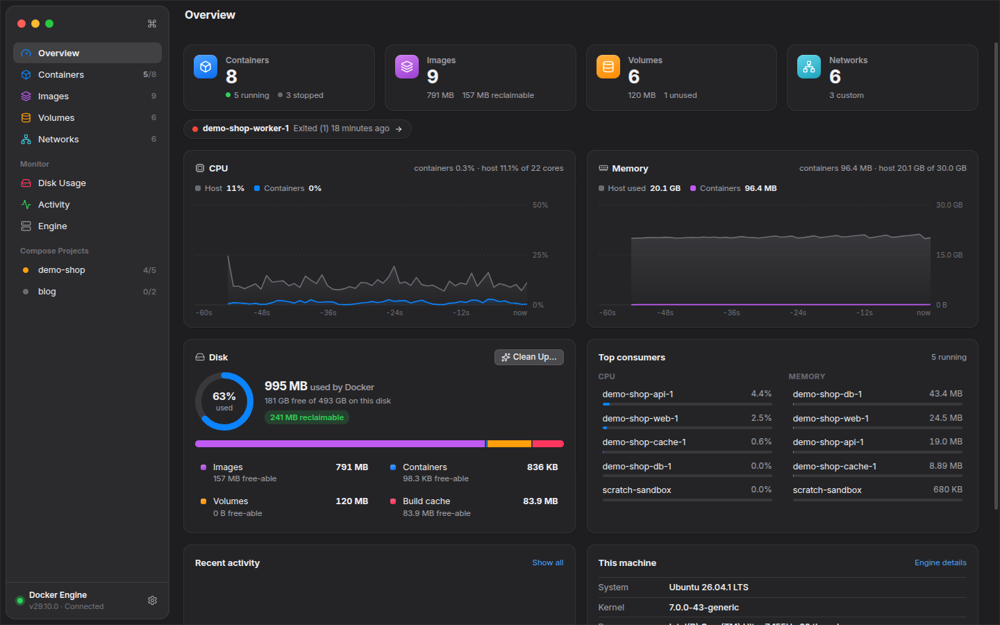
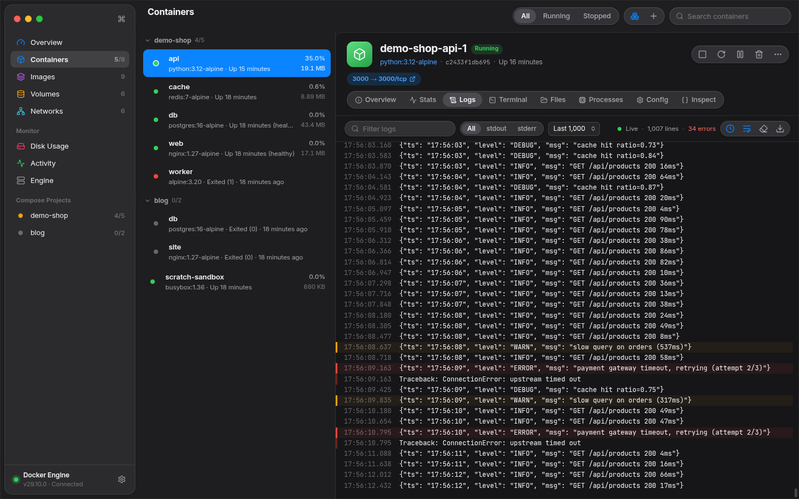
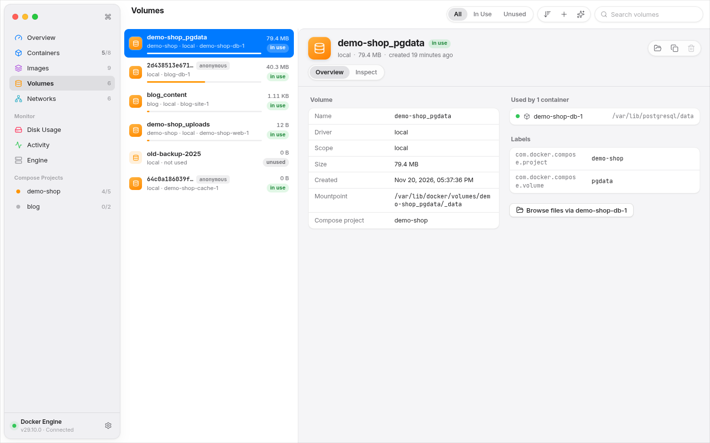
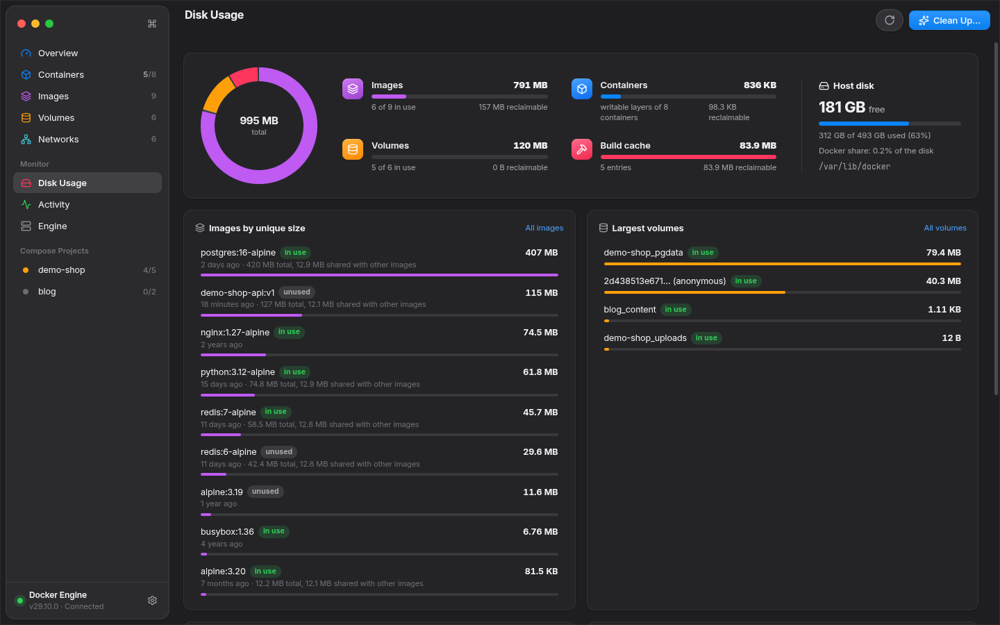
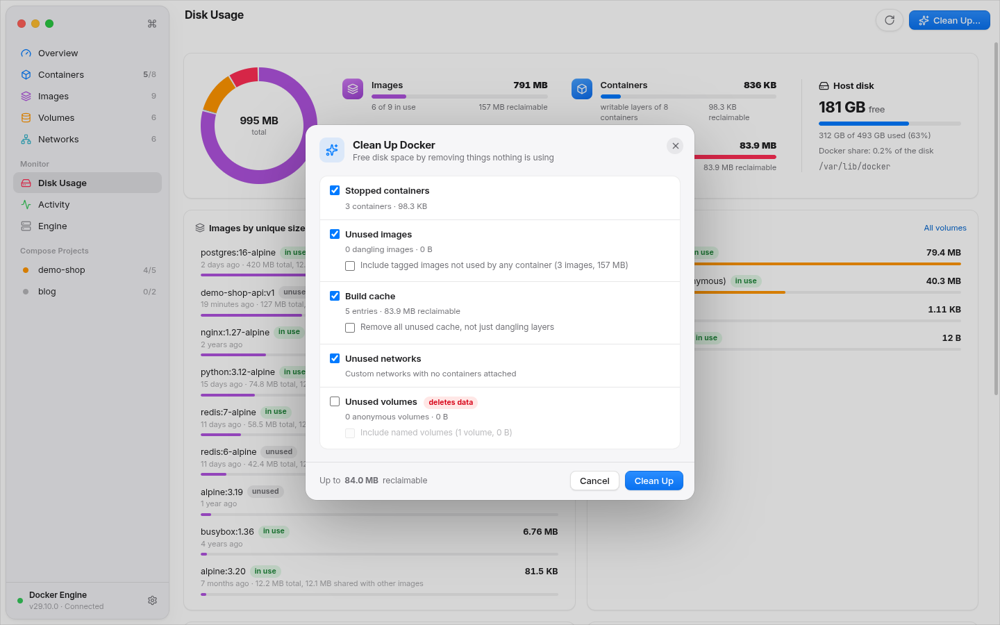
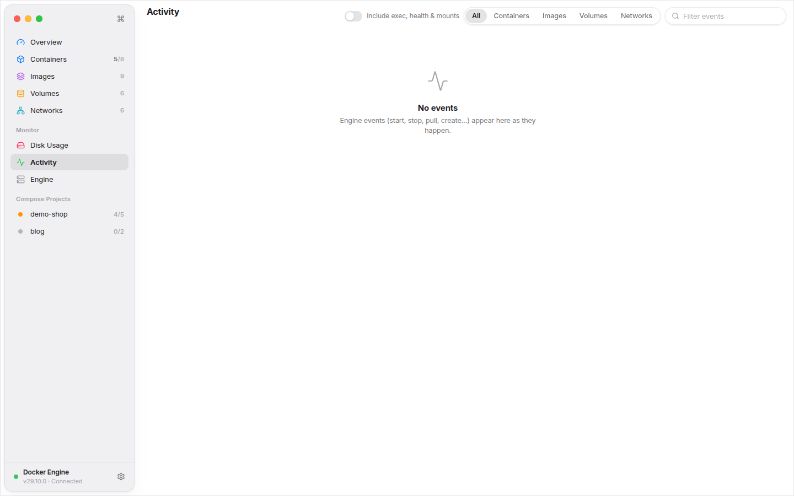
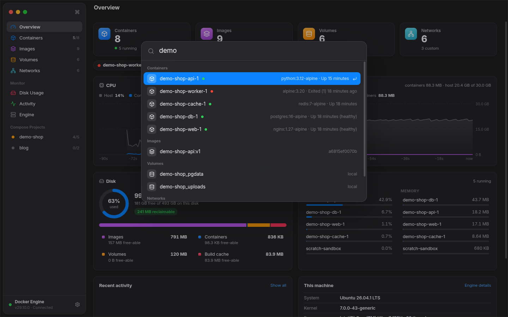
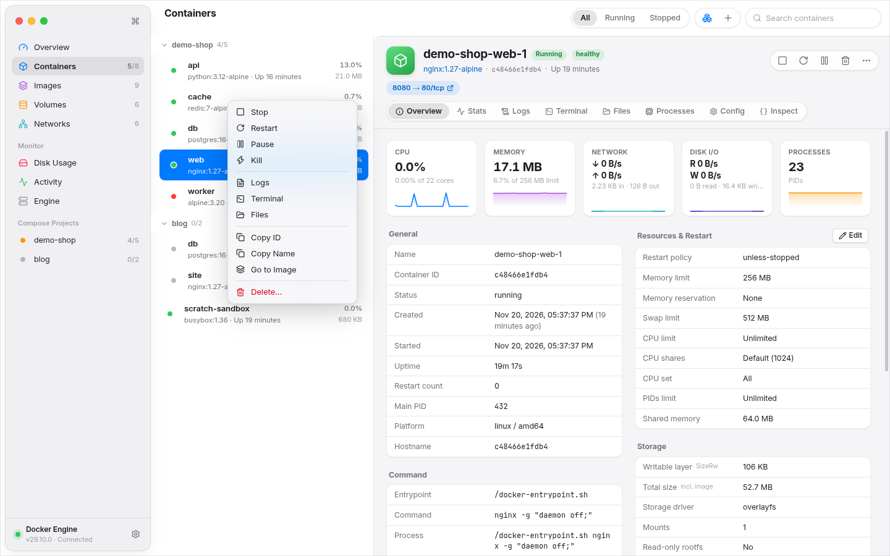

<h1 align="center">
  <br>
  Docker Inspector
</h1>

<p align="center">
  A native-feeling desktop app for Linux that shows <b>everything</b> about the Docker containers on your machine —
  live resource usage, logs, an interactive shell, files, configuration and storage — and lets you act on them.<br>
  Designed after macOS apps: floating sidebar, glass toolbars, inset grouped lists, sheets, light &amp; dark mode.
</p>

<p align="center">
  
</p>

> All screenshots in this README were taken from a throw-away Docker engine running a fake
> "demo-shop" project, so they contain no real data. See [Regenerating the screenshots](#regenerating-the-screenshots).

---

## Table of contents

- [Quick start](#quick-start)
- [Tour](#tour)
- [Usage](#usage)
- [Connecting to a different engine](#connecting-to-a-different-engine)
- [Architecture](#architecture)
- [Security](#security)
- [Development](#development)
- [Regenerating the screenshots](#regenerating-the-screenshots)

## Quick start

```bash
git clone https://github.com/Med-Dev-99/Docker-inspector.git
cd Docker-inspector
npm install               # once
npm start                 # build the UI and open the app
npm run install-desktop   # (optional) add "Docker Inspector" to the GNOME app grid
```

**Requirements:** Node.js 20+, Docker Engine reachable at `/var/run/docker.sock`
(rootless `$XDG_RUNTIME_DIR/docker.sock` and Docker Desktop sockets are auto-detected) and your
user in the `docker` group.

| Command | What it does |
| --- | --- |
| `npm start` | Build the UI and open the desktop app |
| `npm run app` | Open the app without rebuilding (after `npm run build`) |
| `npm run dev` | Hot-reloading UI (Vite) inside Electron |
| `npm run web` | No Electron: serve the UI and open it in a Chrome/Brave app window |
| `npm run build` | Production build of the UI into `dist/` |
| `npm run typecheck` | TypeScript type-check |
| `npm run icon` | Re-render `build/icons/*.png` from `public/icon.svg` |
| `npm run install-desktop` | Install the launcher (`-- --uninstall` removes it) |

> **Heads-up for VS Code users:** VS Code's integrated terminal sets `ELECTRON_RUN_AS_NODE=1`, which makes
> a bare `electron .` run as plain Node. The npm scripts and the desktop launcher already clear it.

## Tour

### Overview

Container / image / volume / network counts, live **host vs. container** CPU and memory charts, a disk
usage breakdown with a low-space warning, the biggest resource consumers, crashed or unhealthy
containers, and the latest engine activity — all updating in real time.

### Containers — everything about one container

Containers are grouped by **Docker Compose project**. Start, stop, restart, pause, kill, rename and
delete from the toolbar or the right-click menu, or act on a whole project at once. Each container has eight tabs:

<table>
  <tr>
    <td width="50%"></td>
    <td width="50%"></td>
  </tr>
  <tr>
    <td><b>Overview</b> — live CPU / memory / network / disk I/O / PID tiles with sparklines, state and uptime, exit codes, command, health-check history, editable restart policy &amp; limits, storage and Compose metadata.</td>
    <td><b>Stats</b> — five-minute live charts for CPU, memory, network and block I/O, and process count, with hover read-outs.</td>
  </tr>
  <tr>
    <td></td>
    <td></td>
  </tr>
  <tr>
    <td><b>Logs</b> — live streaming with ANSI colours, error / warning highlighting, stdout/stderr filter, search, timestamps, wrapping, follow mode and download.</td>
    <td><b>Terminal</b> — a real interactive shell inside the container (bash / sh / ash / zsh, any user) powered by xterm.js.</td>
  </tr>
  <tr>
    <td></td>
    <td></td>
  </tr>
  <tr>
    <td><b>Files</b> — browse the container filesystem, see which paths are mounts, preview text files and download files or folders as tar archives.</td>
    <td><b>Config</b> — environment variables (secrets are masked until you reveal them), ports, mounts, networks, labels, security options, DNS and logging.</td>
  </tr>
</table>

The remaining two tabs are **Processes** (live `ps aux` with sorting and filtering) and **Inspect**
(searchable JSON tree or raw JSON, copy &amp; save).

### Images, volumes and networks

<table>
  <tr>
    <td width="50%"></td>
    <td width="50%"></td>
  </tr>
  <tr>
    <td><b>Images</b> — in-use / unused / dangling filters, <i>unique</i> size (what deleting an image would really free), layer-by-layer build history, which containers use it. Run, pull (with per-layer progress), tag, delete.</td>
    <td><b>Volumes</b> — real sizes, which containers mount them and where, one-click file browsing through a container, create and delete.</td>
  </tr>
</table>

<p align="center"></p>

**Networks** — subnets, gateways, driver options, and every connected container with its IP and MAC; connect,
disconnect, create and delete.

### Disk usage and Clean Up

<table>
  <tr>
    <td width="50%"></td>
    <td width="50%"></td>
  </tr>
  <tr>
    <td><b>Disk Usage</b> — images / containers / volumes / build cache, what is reclaimable, the largest items, and your host disk at a glance.</td>
    <td><b>Clean Up</b> — pick what to remove and see the estimated space first. Volumes are opt-in and need a second confirmation because they delete data.</td>
  </tr>
</table>

### Activity, quick open and context menus

<table>
  <tr>
    <td width="33%"></td>
    <td width="33%"></td>
    <td width="33%"></td>
  </tr>
  <tr>
    <td><b>Activity</b> — live engine events for the last 24 hours, filterable. Desktop notifications when a container crashes or is OOM-killed.</td>
    <td><b>Quick open</b> (<kbd>Ctrl</kbd>+<kbd>K</kbd>) — Spotlight-style jump to any container, image, volume or network.</td>
    <td><b>Right-click</b> any container, image, volume or network for its actions.</td>
  </tr>
</table>

The **Engine** page lists version, components, storage driver, cgroups, runtimes, plugins, security and registry settings.

## Usage

| Shortcut | Action |
| --- | --- |
| <kbd>Ctrl</kbd>+<kbd>K</kbd> | Quick open |
| <kbd>Ctrl</kbd>+<kbd>1</kbd> … <kbd>8</kbd> | Switch section (Overview, Containers, Images, Volumes, Networks, Disk Usage, Activity, Engine) |
| <kbd>Ctrl</kbd>+<kbd>F</kbd> | Focus the search field |
| <kbd>↑</kbd> / <kbd>↓</kbd> | Move through the container list |
| <kbd>Esc</kbd> | Close sheets, menus and the palette |

Typical workflows:

- **"Why is my disk full?"** → *Disk Usage* shows where the space goes → *Clean Up…* removes stopped containers,
  dangling images, unused networks and build cache (volumes only if you opt in).
- **"What is this container doing?"** → *Containers → Logs* (errors highlighted) and *Stats* (live charts).
- **"Let me poke around inside"** → *Terminal* for a shell, *Files* to browse and download, *Processes* for `ps`.
- **"Run something quickly"** → the **+** button in *Containers* opens a friendly `docker run` form
  (ports, env, volumes, network, restart policy); missing images are pulled automatically.
- **Compose projects** → click a project in the sidebar to start / stop / restart / delete all of its containers.

Settings (⚙ at the bottom of the sidebar): Automatic / Light / Dark appearance and crash notifications.

## Connecting to a different engine

By default the app uses the local Unix socket. Set `DOCKER_HOST` to point somewhere else:

```bash
DOCKER_HOST=unix:///run/user/1000/docker.sock npm start   # rootless Docker
DOCKER_HOST=tcp://127.0.0.1:2375 npm start                # plain-TCP engine (no TLS)
```

Only plain `tcp://` is supported (no TLS). Never expose an unauthenticated engine port beyond localhost.

## Architecture

```
electron/main.js     Frameless window; starts the backend in-process
electron/preload.cjs Safe bridge for window controls and notifications
server/docker.js     Docker Engine API client over the unix socket / TCP (no SDK)
server/hub.js        Stats streams for running containers, event stream, host metrics
server/server.js     127.0.0.1 HTTP + WebSocket: engine proxy, logs, exec, files
src/                 React UI (Vite): views/, components/, lib/
scripts/             Dev runner, desktop-launcher installer, icon renderer
```

The UI never talks to Docker directly. It calls the local backend, which proxies the Engine API and adds the
things the API doesn't give you for free: multiplexed live stats, log streaming, an interactive exec
session over a hijacked connection, and a file browser built on `exec`.

## Security

Access to the Docker socket is root-equivalent, so the backend:

- listens on `127.0.0.1` only,
- requires a random per-launch token on every API and WebSocket call,
- validates the `Host` and `Origin` headers, which blocks cross-site requests and DNS-rebinding attacks from
  web pages open in your browser.

## Development

```bash
npm run dev        # Vite + Electron with hot reload (backend on :7781)
npm run typecheck  # tsc --noEmit
```

Stack: Electron, React 19, Vite, TypeScript, TanStack Query, xterm.js, hand-rolled SVG charts.

## Regenerating the screenshots

The pictures in `docs/screenshots/` were captured with the app's built-in screenshot mode against a disposable
Docker-in-Docker engine, so no personal containers appear in them:

```bash
# 1. a throw-away engine listening on localhost:23750
docker run -d --name di-demo-engine --privileged -e DOCKER_TLS_CERTDIR= -p 127.0.0.1:23750:2375 docker:dind
# 2. create some demo containers in it (DOCKER_HOST=tcp://127.0.0.1:23750 docker run ...), then:
DOCKER_HOST=tcp://127.0.0.1:23750 \
DI_SHOT=/tmp/shots DI_SHOT_THEME=dark \
DI_SHOT_ROUTES="/overview,/containers,/images,/storage" \
npx electron . --user-data-dir=/tmp/di-shots-profile
# 3. clean up
docker rm -f di-demo-engine
```

`DI_SHOT_ROUTES` is a comma- or newline-separated list of in-app routes; append `@@file:/path/to/snippet.js`
to a route to run a JavaScript snippet in the page before the capture.
