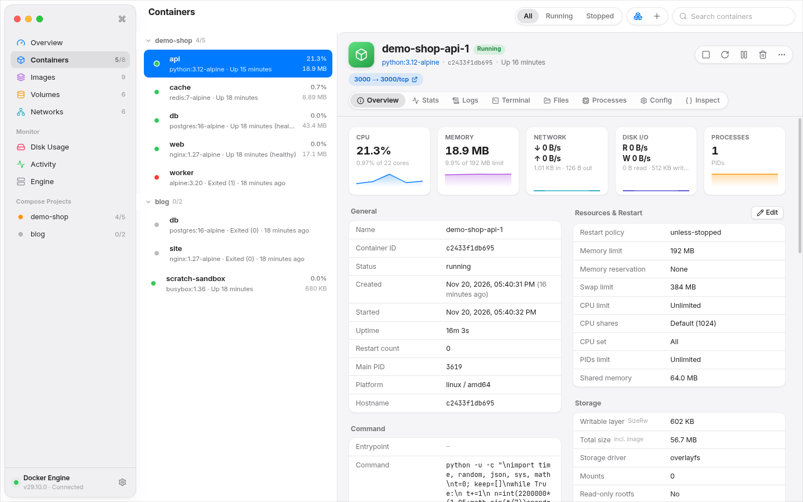
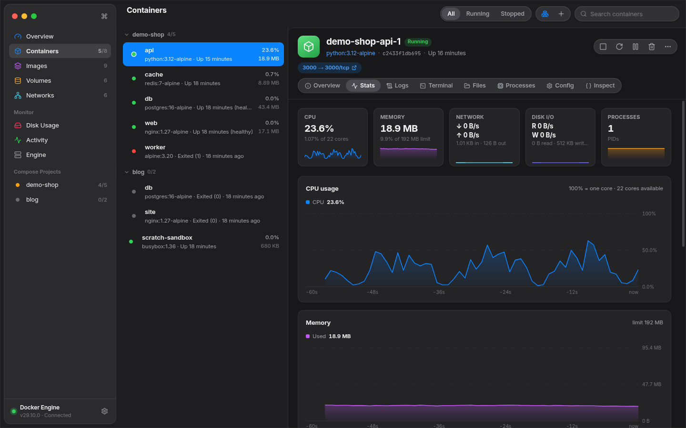
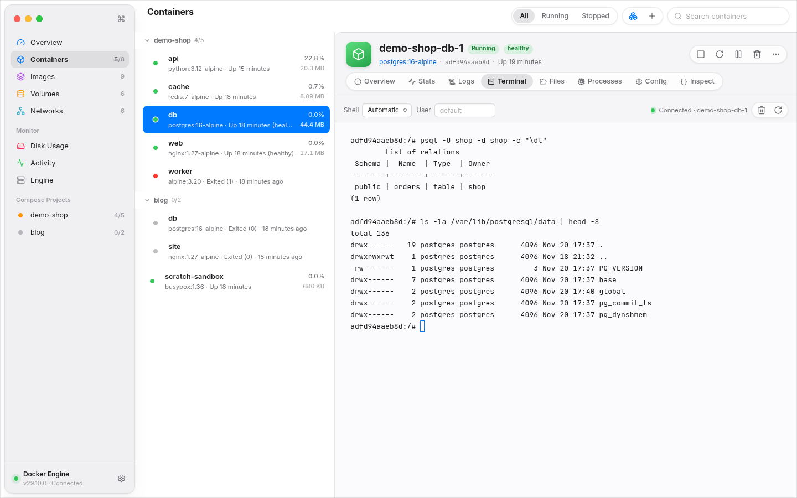
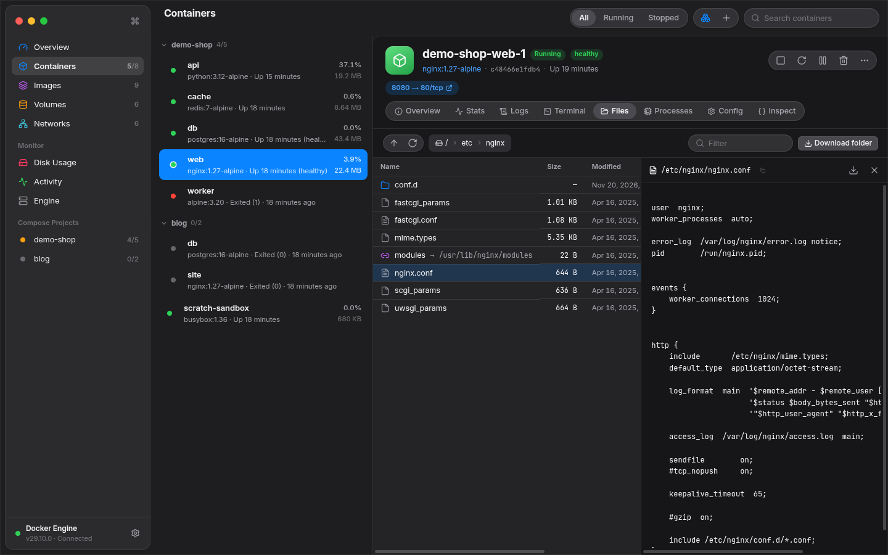
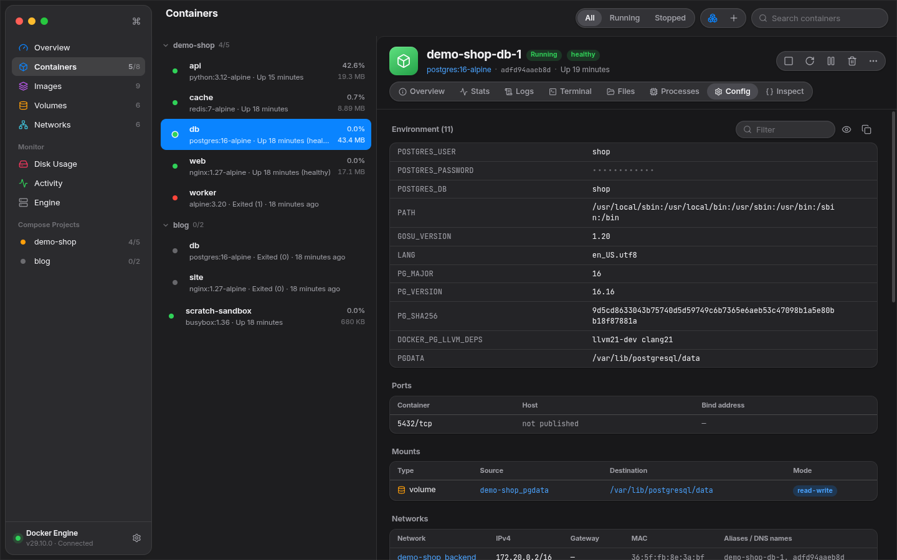
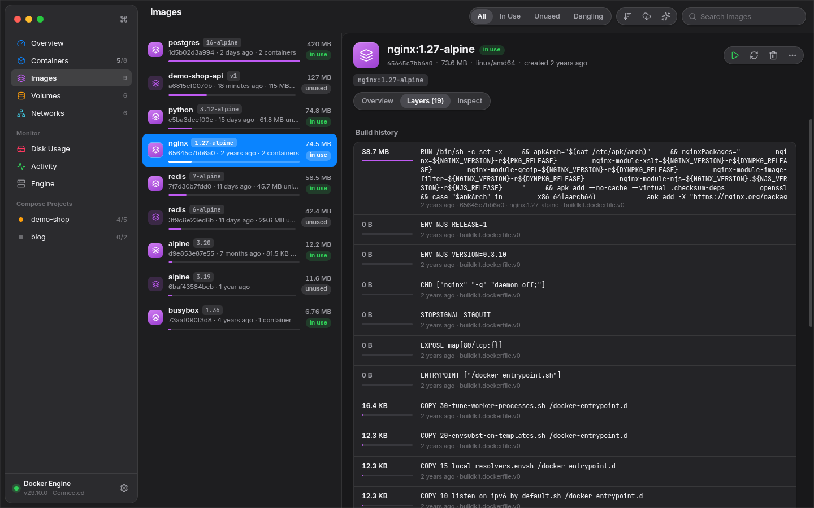
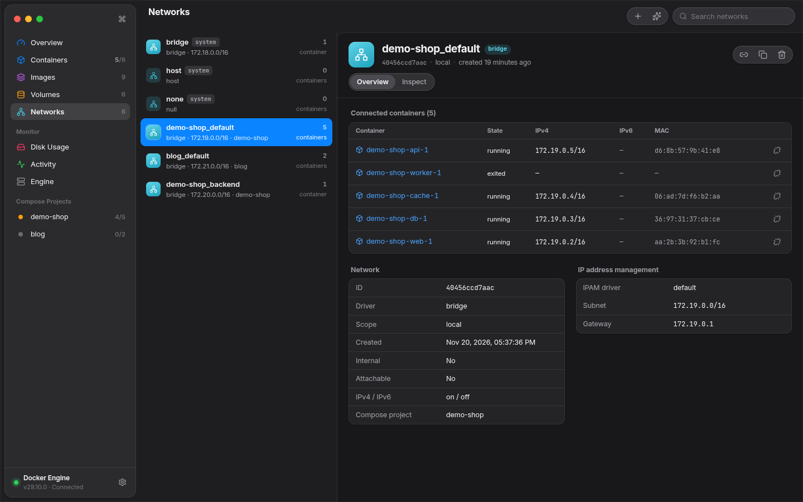

<h1 align="center">
  <br>
  Docker Inspector
</h1>

<p align="center">
  A native-feeling desktop app for Linux that shows <b>everything</b> about the Docker containers on your machine —
  live resource usage, logs, an interactive shell, files, configuration and storage — and lets you act on them.<br>
  Designed after macOS apps: floating sidebar, glass toolbars, inset grouped lists, sheets, light &amp; dark mode.
</p>

<p align="center">
  
</p>

> All screenshots in this README were taken from a throw-away Docker engine running a fake
> "demo-shop" project, so they contain no real data. See [Regenerating the screenshots](#regenerating-the-screenshots).

## Why Docker Inspector?

Docker Desktop shows you what is running. **Docker Inspector tells you what is wrong, and what happened while you were not looking.**

- **A black box for your containers.** It records CPU, memory and events in the background. When a container dies it saves a
  crash report: the cause in plain English (out of memory, missing module, database login failed, dependency down, ...),
  the evidence, the last log lines and the seconds of metrics before the crash, plus a fix you can apply.
- **A time machine.** Scrub back through 7 days of history and click any moment to see what was running and what happened around it.
- **A Doctor for your setup.** It audits how your containers are *configured*: ports open to your whole network (including the
  well-known case where Docker bypasses the UFW firewall), no memory limit, logs growing without limit, outdated images,
  crash loops, secrets in environment variables, and more. Every finding has a one-click or copy-paste fix and the whole thing
  boils down to a score per container.
- **Your real engine, no VM.** It talks to any Docker socket: the native Linux engine, rootless Docker, Docker Desktop or a TCP
  endpoint. On Linux, Docker Desktop runs its own virtual machine with its own separate containers and images.
- **Free, local and private.** MIT licensed, no account, no sign-in, no telemetry. History and crash reports never leave your machine.

| | Docker Desktop | Docker Inspector |
| --- | --- | --- |
| Why did a container die? | Exit code and logs; you work out the cause | Diagnosis, evidence, fix, and the metrics from just before it died |
| Resource usage over time | Live view (history needs an extension) | 7 days built in, with a clickable timeline and crash markers |
| Configuration and security audit | Image vulnerability scanning (Docker Scout) | Doctor: exposed ports, UFW bypass, limits, log growth, outdated images, secrets |
| Works with your native Linux engine | Uses its own VM and engine (`desktop-linux` context) | Any socket: native, rootless, Desktop or TCP |
| Runs in the background | Needs the whole Desktop app | Tray icon, optional start at login, desktop notifications on crashes |
| Cost and account | Paid for larger companies; some features need sign-in | MIT, no account |

Where Docker Desktop is the better choice: Kubernetes, the Docker Scout vulnerability database, Docker's AI and model features, the
extensions marketplace, and macOS/Windows support. Docker Inspector deliberately focuses on understanding and operating the containers
you already run.

---

## Table of contents

- [Why Docker Inspector?](#why-docker-inspector)
- [Quick start](#quick-start)
- [Run with Docker](#run-with-docker)
- [Tour](#tour)
- [Usage](#usage)
- [Connecting to a different engine](#connecting-to-a-different-engine)
- [Architecture](#architecture)
- [Privacy](#privacy)
- [Security](#security)
- [Development](#development)
- [Regenerating the screenshots](#regenerating-the-screenshots)

## Quick start

```bash
git clone https://github.com/Med-Dev-99/Docker-inspector.git
cd Docker-inspector
npm install               # once
npm start                 # build the UI and open the app
npm run install-desktop   # (optional) add "Docker Inspector" to the GNOME app grid
```

**Requirements:** Node.js 20+, Docker Engine reachable at `/var/run/docker.sock`
(rootless `$XDG_RUNTIME_DIR/docker.sock` and Docker Desktop sockets are auto-detected) and your
user in the `docker` group.

| Command | What it does |
| --- | --- |
| `npm start` | Build the UI and open the desktop app |
| `npm run app` | Open the app without rebuilding (after `npm run build`) |
| `npm run dev` | Hot-reloading UI (Vite) inside Electron |
| `npm run web` | No Electron: serve the UI and open it in a Chrome/Brave app window |
| `npm run build` | Production build of the UI into `dist/` |
| `npm run typecheck` | TypeScript type-check |
| `npm run icon` | Re-render `build/icons/*.png` from `public/icon.svg` |
| `npm run install-desktop` | Install the launcher (`-- --uninstall` removes it) |

> **Heads-up for VS Code users:** VS Code's integrated terminal sets `ELECTRON_RUN_AS_NODE=1`, which makes
> a bare `electron .` run as plain Node. The npm scripts and the desktop launcher already clear it.

## Run with Docker

Prefer not to install Node.js? Run Docker Inspector itself as a container and open it in your browser.
The desktop shell (Electron) is not part of the image; the container runs the same backend and UI in web mode.

```bash
cp .env.example .env              # then edit it (see below)
docker compose up -d --build
```

Open **http://localhost:7780/?t=&lt;your DI_TOKEN&gt;** — the token is the one from `.env`. If you leave `DI_TOKEN`
empty, a random token is generated and printed by `docker compose logs`.

What to put in `.env`:

| Variable | Meaning |
| --- | --- |
| `DOCKER_GID` | Group that owns the Docker socket **inside the container** (see below). |
| `DI_TOKEN` | Access token, at least 16 characters: `openssl rand -hex 24`. Empty = random on every start. |
| `DI_PORT` | Host port published on `127.0.0.1` (default `7780`). |
| `DI_ALLOWED_HOSTS` | `host:port` values your browser uses to reach the app (default `localhost:<DI_PORT>`). Only needed behind a reverse proxy or another hostname. |
| `DI_DATA_DIR` | Where history and crash reports are stored. The image uses the `/data` volume (default `~/.local/share/docker-inspector` outside Docker). |
| `DI_HISTORY_DAYS` | How many days of one-minute history to keep (default `7`). |

**Which `DOCKER_GID`?** The container runs as an unprivileged user and must be in the group that owns the socket:

- **Native Docker Engine** — the socket belongs to your `docker` group: `getent group docker | cut -d: -f3`.
- **Docker Desktop for Linux** — the socket appears as `root:root` in containers, so use `0`.
- Not sure? Start the container; if the value is wrong the log tells you exactly which one to use
  (`docker compose logs`).

Plain `docker run` works too:

```bash
docker build -t docker-inspector .
docker run -d --name docker-inspector --restart unless-stopped \
  -p 127.0.0.1:7780:7780 \
  -v /var/run/docker.sock:/var/run/docker.sock \
  --group-add "$(getent group docker | cut -d: -f3)" \
  -e DI_TOKEN="$(openssl rand -hex 24)" \
  -e DI_ALLOWED_HOSTS=localhost:7780 \
  --read-only --tmpfs /tmp --cap-drop ALL --security-opt no-new-privileges:true \
  docker-inspector
docker logs docker-inspector     # prints the URL including the token
```

About the container image:

- Multi-stage build on `node:22-alpine` (about 240 MB): the UI is built in one stage, only the production
  dependency (`ws`) and the compiled UI are copied into the runtime stage. The Electron binary is never downloaded.
- History, crash reports and Doctor settings are kept in the `docker-inspector-data` volume (`/data`), so they survive updates and restarts.
- Runs as the unprivileged `node` user, with a read-only filesystem, all Linux capabilities dropped, `no-new-privileges`,
  and a built-in health check (`docker ps` shows `healthy`).
- The port is published on **loopback only** (`127.0.0.1`). Inside the container the server listens on `0.0.0.0`,
  which is why every request is protected by the token and by Host/Origin checks.

> **Security:** mounting the Docker socket gives the container (and anyone with the token) root-equivalent control
> of the machine running the engine. `:ro` on the socket does **not** make the Docker API read-only. Keep the
> published port on `127.0.0.1`, keep the token secret, and put proper authentication and TLS in front of it
> before you ever expose it to a network.

Differences from the desktop app:

- It talks to whichever engine serves the mounted socket. On Docker Desktop that is Docker Desktop's own engine,
  which can be a different one from a native `dockerd` running on the host.
- There is no native window, tray or desktop notification: use the browser tab. Recording and crash detection keep running in the container, and crash alerts appear as in-app toasts while a tab is open.
- Host CPU, memory, uptime and disk figures describe the machine that runs the engine (the Docker Desktop VM, if you use it).

## Tour

### Overview

Container / image / volume / network counts, live **host vs. container** CPU and memory charts, a disk
usage breakdown with a low-space warning, the biggest resource consumers, crashed or unhealthy
containers, and the latest engine activity — all updating in real time.

### Crash reports — why did it die?

When a container stops unexpectedly, Docker Inspector saves a report right away (and notifies you). Clean stops, `docker stop`
and Ctrl+C exits are not reported. Crash loops are merged into one report with a counter instead of flooding you.

<p align="center"></p>

Each report has:

- **What happened** in plain English: out of memory, Node or Java heap exhausted, missing module or library, command not found,
  port already in use, database login failed, dependency not reachable, disk full, wrong CPU architecture, permission denied,
  invalid configuration, unhandled exceptions, segmentation faults, and more (exit codes explained too).
- **Evidence**: the exit code, the log line the diagnosis is based on (highlighted), how long it ran, memory climbing like a
  leak or jumping like a spike, health-check failures, dependencies that were down, crash-loop detection.
- **How to fix it**, with copy buttons, and an **Apply** button for memory limits.
- The **seconds of CPU and memory before the crash**, the last 200 log lines, the container's configuration at the time, earlier crashes of
  the same container, and **Copy as Markdown** to paste the whole thing into an issue or chat.

Crashes that happened while the app was closed are picked up the next time it starts.

### Timeline — the time machine

<p align="center"></p>

CPU and memory of your machine and of your containers for the last hour, 6 hours, 24 hours or 7 days, stored locally
(about 10-second resolution for the last 2 days, one-minute resolution after that). Hatched areas mean "not recording",
dots are crashes. **Click any point** to see which containers were running then, how busy they were and what happened in the
5 minutes around it. Click a container in the table to chart just that one; the container's **Stats** tab has the same history ranges.

### Doctor — a health check for your setup

<p align="center"></p>

Every container gets a grade, and so does the whole engine. Findings are grouped by severity and category:

| Area | Examples |
| --- | --- |
| Security | Database or admin ports published to your whole network; ports that **bypass UFW**; Docker socket mounted; privileged mode; dangerous capabilities; host network or PID namespace; running as root; secrets in environment variables |
| Reliability | Crash loops; failing health checks; no restart policy; no health check |
| Resources | No memory limit; memory close to its limit; recent out-of-memory kills |
| Upkeep | Log files without rotation; `:latest` tags; containers running an **outdated image** after a rebuild; nearly full disk; reclaimable space; no default log rotation in `daemon.json` |

Findings come with fixes: a Compose snippet or `docker run` flag to copy, or a button that applies the change to the running
container (for example "Limit to 256 MB" or "Restart unless stopped"). Findings you do not care about can be ignored, per container or everywhere,
and restored later.

### Containers — everything about one container

Containers are grouped by **Docker Compose project**. Start, stop, restart, pause, kill, rename and
delete from the toolbar or the right-click menu, or act on a whole project at once. Each container has eight tabs:

<table>
  <tr>
    <td width="50%"></td>
    <td width="50%"></td>
  </tr>
  <tr>
    <td><b>Overview</b> — live CPU / memory / network / disk I/O / PID tiles with sparklines, state and uptime, exit codes, command, health-check history, editable restart policy &amp; limits, storage and Compose metadata.</td>
    <td><b>Stats</b> — five-minute live charts for CPU, memory, network and block I/O, and process count, with hover read-outs.</td>
  </tr>
  <tr>
    <td></td>
    <td></td>
  </tr>
  <tr>
    <td><b>Logs</b> — live streaming with ANSI colours, error / warning highlighting, stdout/stderr filter, search, timestamps, wrapping, follow mode and download.</td>
    <td><b>Terminal</b> — a real interactive shell inside the container (bash / sh / ash / zsh, any user) powered by xterm.js.</td>
  </tr>
  <tr>
    <td></td>
    <td></td>
  </tr>
  <tr>
    <td><b>Files</b> — browse the container filesystem, see which paths are mounts, preview text files and download files or folders as tar archives.</td>
    <td><b>Config</b> — environment variables (secrets are masked until you reveal them), ports, mounts, networks, labels, security options, DNS and logging.</td>
  </tr>
</table>

The remaining two tabs are **Processes** (live `ps aux` with sorting and filtering) and **Inspect**
(searchable JSON tree or raw JSON, copy &amp; save).

### Images, volumes and networks

<table>
  <tr>
    <td width="50%"></td>
    <td width="50%"></td>
  </tr>
  <tr>
    <td><b>Images</b> — in-use / unused / dangling filters, <i>unique</i> size (what deleting an image would really free), layer-by-layer build history, which containers use it. Run, pull (with per-layer progress), tag, delete.</td>
    <td><b>Volumes</b> — real sizes, which containers mount them and where, one-click file browsing through a container, create and delete.</td>
  </tr>
</table>

<p align="center"></p>

**Networks** — subnets, gateways, driver options, and every connected container with its IP and MAC; connect,
disconnect, create and delete.

### Disk usage and Clean Up

<table>
  <tr>
    <td width="50%"></td>
    <td width="50%"></td>
  </tr>
  <tr>
    <td><b>Disk Usage</b> — images / containers / volumes / build cache, what is reclaimable, the largest items, and your host disk at a glance.</td>
    <td><b>Clean Up</b> — pick what to remove and see the estimated space first. Volumes are opt-in and need a second confirmation because they delete data.</td>
  </tr>
</table>

### Activity, quick open and context menus

<table>
  <tr>
    <td width="33%"></td>
    <td width="33%"></td>
    <td width="33%"></td>
  </tr>
  <tr>
    <td><b>Activity</b> — live engine events for the last 24 hours, filterable. Desktop notifications when a container crashes or is OOM-killed.</td>
    <td><b>Quick open</b> (<kbd>Ctrl</kbd>+<kbd>K</kbd>) — Spotlight-style jump to any container, image, volume or network.</td>
    <td><b>Right-click</b> any container, image, volume or network for its actions.</td>
  </tr>
</table>

The **Engine** page lists version, components, storage driver, cgroups, runtimes, plugins, security and registry settings.

## Usage

| Shortcut | Action |
| --- | --- |
| <kbd>Ctrl</kbd>+<kbd>K</kbd> | Quick open |
| <kbd>Ctrl</kbd>+<kbd>1</kbd> … <kbd>8</kbd> | Switch section (Overview, Containers, Images, Volumes, Networks, Disk Usage, Activity, Engine) |
| <kbd>Ctrl</kbd>+<kbd>F</kbd> | Focus the search field |
| <kbd>↑</kbd> / <kbd>↓</kbd> | Move through the container list |
| <kbd>Esc</kbd> | Close sheets, menus and the palette |

Typical workflows:

- **"Why is my disk full?"** → *Disk Usage* shows where the space goes → *Clean Up…* removes stopped containers,
  dangling images, unused networks and build cache (volumes only if you opt in).
- **"What is this container doing?"** → *Containers → Logs* (errors highlighted) and *Stats* (live charts).
- **"Let me poke around inside"** → *Terminal* for a shell, *Files* to browse and download, *Processes* for `ps`.
- **"Run something quickly"** → the **+** button in *Containers* opens a friendly `docker run` form
  (ports, env, volumes, network, restart policy); missing images are pulled automatically.
- **Compose projects** → click a project in the sidebar to start / stop / restart / delete all of its containers.

### Background monitoring

History and crash reports are only recorded while Docker Inspector is running, so by default **closing the window keeps it running
in the system tray** (a notification explains this the first time). From the tray menu or the ⚙ menu you can:

- turn *Keep monitoring when closed* off (closing the window then quits the app),
- turn *Start at login* on (installs `~/.config/autostart/docker-inspector.desktop`; the app starts hidden in the tray),
- turn desktop notifications for crashes on or off. Clicking a notification opens its crash report.

Opening Docker Inspector again (from the app grid or a terminal) brings the existing window back. Use **Quit** in the tray menu to stop recording.

Settings (⚙ at the bottom of the sidebar): Automatic / Light / Dark appearance, in-app crash alerts, and the background options above.

## Connecting to a different engine

By default the app uses the local Unix socket. Set `DOCKER_HOST` to point somewhere else:

```bash
DOCKER_HOST=unix:///run/user/1000/docker.sock npm start   # rootless Docker
DOCKER_HOST=tcp://127.0.0.1:2375 npm start                # plain-TCP engine (no TLS)
```

Only plain `tcp://` is supported (no TLS). Never expose an unauthenticated engine port beyond localhost.

## Architecture

```
electron/main.js     Frameless window; starts the backend in-process
electron/preload.cjs Safe bridge for window controls and notifications
server/docker.js     Docker Engine API client over the unix socket / TCP (no SDK)
server/hub.js        Stats streams for running containers, event stream, host metrics, crash detection
server/store.js      Local SQLite history (node:sqlite): metrics, events, crash reports, ignores
server/crash.js      Crash analyser: exit codes, log patterns and metrics -> verdict, evidence, fixes
server/doctor.js     Configuration auditor and scoring
server/server.js     127.0.0.1 HTTP + WebSocket: engine proxy, logs, exec, files
src/                 React UI (Vite): views/, components/, lib/
scripts/             Dev runner, desktop-launcher installer, icon renderer
Dockerfile           Multi-stage image that runs the backend + UI in web mode
docker-compose.yml   Hardened, loopback-only deployment of that image (config in .env)
```

The UI never talks to Docker directly. It calls the local backend, which proxies the Engine API and adds the
things the API doesn't give you for free: multiplexed live stats, log streaming, an interactive exec
session over a hijacked connection, and a file browser built on `exec`.

## Privacy

Everything stays on your machine. History and crash reports (which include the last log lines of a crashed container) are stored in a local SQLite
file, and Docker Inspector makes no network requests of its own. The only thing that leaves your machine is what *you* choose to copy,
for example a crash report as Markdown. To delete everything, quit the app and remove the data folder
(`~/.config/Docker Inspector/data` for the desktop app).

## Security

Access to the Docker socket is root-equivalent, so the backend:

- listens on `127.0.0.1` only (in the container image it binds `0.0.0.0` inside, and Compose publishes the port on `127.0.0.1` only),
- requires a random per-launch token on every API and WebSocket call,
- validates the `Host` and `Origin` headers, which blocks cross-site requests and DNS-rebinding attacks from
  web pages open in your browser.

## Development

```bash
npm run dev        # Vite + Electron with hot reload (backend on :7781)
npm run typecheck  # tsc --noEmit
```

Stack: Electron, React 19, Vite, TypeScript, TanStack Query, xterm.js, hand-rolled SVG charts.

## Regenerating the screenshots

The pictures in `docs/screenshots/` were captured with the app's built-in screenshot mode against a disposable
Docker-in-Docker engine, so no personal containers appear in them:

```bash
# 1. a throw-away engine listening on localhost:23750
docker run -d --name di-demo-engine --privileged -e DOCKER_TLS_CERTDIR= -p 127.0.0.1:23750:2375 docker:dind
# 2. create some demo containers in it (DOCKER_HOST=tcp://127.0.0.1:23750 docker run ...), then:
DOCKER_HOST=tcp://127.0.0.1:23750 \
DI_SHOT=/tmp/shots DI_SHOT_THEME=dark \
DI_SHOT_ROUTES="/overview,/containers,/images,/storage" \
npx electron . --user-data-dir=/tmp/di-shots-profile
# 3. clean up
docker rm -f di-demo-engine
```

`DI_SHOT_ROUTES` is a comma- or newline-separated list of in-app routes; append `@@file:/path/to/snippet.js`
to a route to run a JavaScript snippet in the page before the capture.

## License

Released under the [MIT License](LICENSE).
